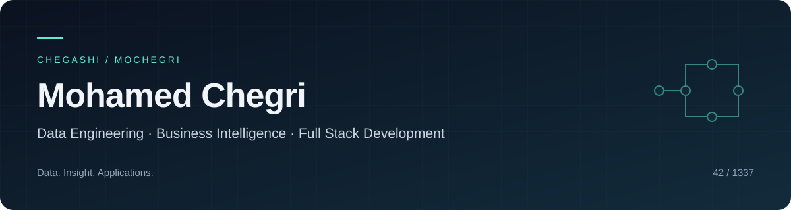

  

  <a href="https://www.linkedin.com/in/mohamedchegri-datadevsecops">LinkedIn</a>
  &nbsp;·&nbsp;
  <a href="mailto:mohamed.chegri@yahoo.com">Email</a>
  &nbsp;·&nbsp;
  <a href="https://github.com/Chegashi?tab=repositories">Repositories</a>
  &nbsp;·&nbsp;
  <strong>42 / 1337 · mochegri</strong>

I’m **Mohamed Chegri**, a data engineer, business intelligence engineer, and full stack engineer.

I build data pipelines and systems at **Mohammed VI Polytechnic University (UM6P)**, turning raw data into datasets for analytics and decision-making. My focus spans **data engineering**, **business intelligence**, and **full stack development**: from collecting and transforming data to building applications that make it useful.

Based in **Morocco**, I hold a **Licence in Mathematics and Computer Science from Université Cadi Ayyad (2021)** and continue developing my software engineering skills through **1337 / the 42 Network**.

## Experience

**Data Engineer · UM6P**

February 2023 — Present

- Design, build, and operate data pipelines and systems.
- Transform heterogeneous data into reliable datasets for analysis.
- Support data-driven decisions across research and operations.

## Featured projects

| Project | What I built | Technologies |
| :--- | :--- | :--- |
| **[37 Companion](https://github.com/Chegashi/37-companion)** | A student dashboard with live 42 data, project and RNCP planning, a calendar, and campus tools. | TypeScript · Next.js · PostgreSQL · Docker · 42 API |
| **[ft_ssl](https://github.com/Chegashi/ft_md5)** | A command-line hashing tool with MD5, SHA-2, and Whirlpool implemented from their specifications, with OpenSSL comparison tests. | C · Make · Shell |
| **[Bgp / BADASS](https://github.com/Chegashi/Bgp)** | Container-based network labs exploring VXLAN and a spine-leaf BGP EVPN fabric, with setup and troubleshooting documentation. | Docker · GNS3 · FRRouting · Shell |

## Data & analytics

My public data projects cover the foundations behind data engineering and analytical work:

- **[Python & Data Science](https://github.com/Chegashi/Piscine_Python_Data_Science.42)** — Python exercises covering data collection, preprocessing, and analysis.
- **[Linear Regression](https://github.com/Chegashi/Ft_linear_regression.42)** — Price prediction with a linear model trained using gradient descent.
- **[DSLR](https://github.com/Chegashi/dslr.42)** — A 42 data science project exploring classification.
- **[Matrix](https://github.com/Chegashi/matrix.42)** — Linear algebra foundations: vectors, matrices, and transformations.

## Toolbox

| Area | Technologies |
| :--- | :--- |
| **Data & databases** | Python · SQL · Pandas · PostgreSQL · MySQL |
| **Full stack** | TypeScript · JavaScript · Next.js · React · HTML · CSS · Flask |
| **Systems & infrastructure** | C · C++ · Linux · Shell · Docker · Git |

## Completed courses & certifications

- **Meta:** Full-Stack Web Development with React; Programming with JavaScript; React Basics; Introduction to Databases.
- **Google:** Ask Questions to Make Data-Driven Decisions.

## More to explore

[minishell](https://github.com/Chegashi/minishell.42) ·
[webserv](https://github.com/Chegashi/webserv.42) ·
[cub3D](https://github.com/Chegashi/cub3d.42) ·
[Inception](https://github.com/Chegashi/Inception.42)

These projects are where I work on the details behind applications: processes, HTTP, graphics, and containerized services.

---

**Let’s connect:** [LinkedIn](https://www.linkedin.com/in/mohamedchegri-datadevsecops) · [Email](mailto:mohamed.chegri@yahoo.com)
